# Connection map

How every piece connects. Solid boxes are built and tested; dashed boxes are planned. Arrows point the way data flows.

```mermaid
flowchart LR
  %% ---------------- laptop ----------------
  subgraph LAPTOP["Laptop · on-device (AGI track)"]
    GAME["Game tab<br/>vel.gg/bo1z/kino"]
    PERC["perception/ (planned)<br/>screen capture → OCR + qwen2.5vl"]
    COACH["coach (planned)<br/>rules from best playbook → voice"]
    GAME -->|frames| PERC
    PERC -->|state dict| COACH
  end

  %% ---------------- shared code ----------------
  subgraph CODE["common/memory.py (built, tested)"]
    SV["state_vector()<br/>importance()"]
    RHS["record_hud_state()"]
    SUM["summarize_round()<br/>$group + $merge"]
    RET["retrieve()<br/>$vectorSearch + $setWindowFields"]
    PLAIN["plain_similar()"]
    REC["record_episode()"]
    LES["lessons_for()<br/>$graphLookup + $vectorSearch"]
    UPD["update_lessons_after_scoring()<br/>transaction"]
    BEST["set_best_playbook()"]
    LIN["playbook_lineage()<br/>$graphLookup"]
    WM["set_working_memory()"]
  end

  %% ---------------- MongoDB ----------------
  subgraph ATLAS["MongoDB Atlas · database zombieloop"]
    HUD[("hud_states<br/>time series")]
    EP[("episodes<br/>🔎 episodes_vec")]
    PB[("playbooks")]
    LS[("lessons<br/>🔎 lessons_vec · $jsonSchema")]
    SIT[("situations<br/>13-node tree")]
    EXP[("experiments")]
    GEN[("generations")]
    WMC[("working_memory<br/>TTL 10 min")]
  end

  %% ---------------- cloud learning ----------------
  subgraph CLOUD["Learning loop (planned) · Luminal API"]
    SIM["evolve/sim.py<br/>train + held-out seeds"]
    LOOP["evolve/loop.py<br/>propose 6 → score → keep best"]
    REFL["reflection<br/>1 lesson / generation"]
  end

  %% ---------------- outputs ----------------
  subgraph OUT["What judges see"]
    DASH["dashboard (planned)<br/>change streams"]
    REPRO["scripts/reproduce_chart.py (built)<br/>→ results/RESULTS.md + chart"]
    MCP["mongodb-mcp-server<br/>plain-English queries"]
  end

  %% laptop → memory
  PERC --> RHS --> HUD
  PERC -.round changes.-> SUM
  HUD --> SUM --> EP
  COACH --> RET
  EP --> RET
  PB -->|"$lookup params"| RET
  RET --> COACH
  COACH --> WM --> WMC
  PB -->|best playbook, cached before play| COACH

  %% learning loop ↔ memory
  LOOP <--> SIM
  SIM --> REC --> EP
  LOOP --> PB
  LOOP --> UPD
  UPD --> PB
  UPD --> LS
  LOOP --> BEST --> PB
  LOOP --> LES
  SIT --> LES
  LS --> LES
  LES --> LOOP
  LOOP --> REFL --> LS
  LOOP --> GEN
  LOOP --> EXP

  %% outputs
  GEN --> REPRO
  EXP --> REPRO
  LS --> REPRO
  HUD --> DASH
  GEN --> DASH
  LS --> DASH
  RET --> DASH
  PLAIN --> DASH
  EP --> PLAIN
  LIN --> DASH
  PB --> LIN
  ATLAS --- MCP
```

## Read it in three loops

| Loop | Speed | Path | Cloud calls |
| --- | --- | --- | --- |
| **Live coaching** | every ~2 s | game → perception → `record_hud_state` → `hud_states`; coach → `retrieve()` over `episodes` → callout → `working_memory` | MongoDB reads only; no model calls |
| **Round summary** | each round change | `hud_states` → `summarize_round()` (`$group` + `$merge`) → `episodes` | none |
| **Evolution** | between games, minutes | `loop.py` reads top playbooks + `lessons_for()` → Luminal proposes 6 → `sim.py` scores (train, then held-out) → `update_lessons_after_scoring()` transaction → `generations` | Luminal API |

## Who owns which arrows

| Owner | Writes | Reads |
| --- | --- | --- |
| A, perception + coach | `hud_states`, `working_memory`, live `episodes` (via `summarize_round`) | `episodes`, `playbooks` |
| B, simulator + loop | `episodes` (sim), `playbooks`, `lessons`, `generations`, `experiments` | `lessons`, `situations`, `playbooks` |
| C, dashboard + submission | `situations` (seeded by `scripts/setup_db.py`) | everything |
