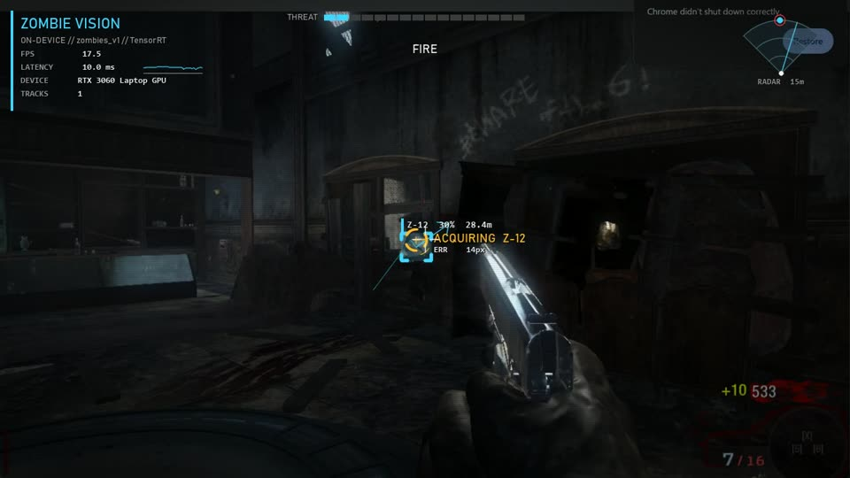
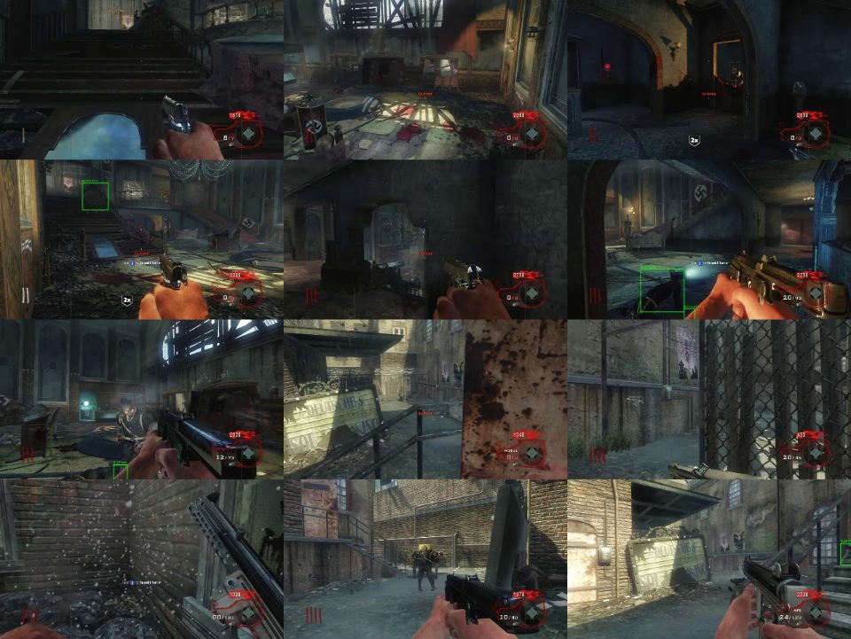
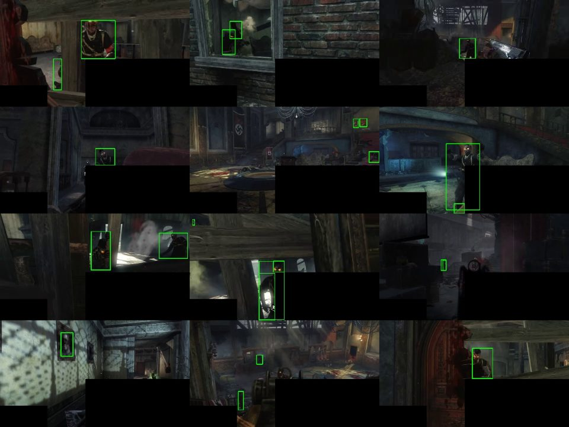
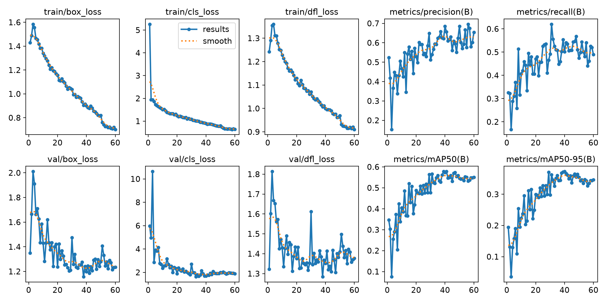
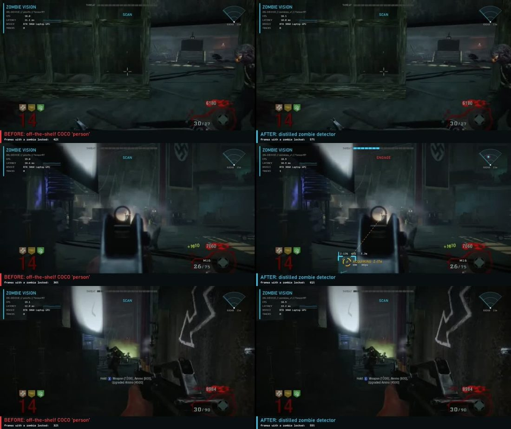
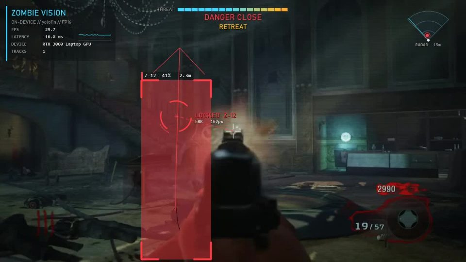

# Zombies Agent: On-Device Vision

The bot's eyes. It captures the game window, finds zombies with a small YOLO model running on the laptop GPU (TensorRT), keeps an ID on each zombie from frame to frame, picks a target, and gives `controller.py` the aim error in pixels. It also draws a tactical HUD over the game for the demo video.

The plan for the whole project is in [`MD files/cod-zombies-agent-plan.md`](cod-zombies-agent-plan.md). This document covers the vision side (plan §5.2 and §5.4, Gate 2).


---

## TL;DR

| | Result |
|---|---|
| Inference speed | **5.9 ms/frame** end to end with TensorRT FP16 on an RTX 3060 Laptop (~170 fps). PyTorch took 20–29 ms. |
| Capture | `dxcam` at 60 fps (its configured cap), `mss` fallback at 52 fps, for a 1280×720 region |
| Gate 2 with the stock COCO "person" model | **Fails.** It finds a zombie in only 21–37% of frames, misses obvious ones, and boxes the player's own hands. |
| Fix | Distillation: YOLOE-L ("zombie") auto-labels gameplay footage, then a yolo11n student trains on those labels. No hand labeling. |
| Student (`zombies_v1`) | Best epoch 39: P 0.62 / R 0.55 / mAP50 0.58 against the teacher's labels on a held-out clip |
| Held-out before/after | Locks onto something in 42% of frames vs 22% for COCO. This counts any lock, false positives included. Proper P/R for both models is still pending. |

**This is a first working version, not a finished detector.** See [Known gaps](#known-gaps--next-steps).

---

## Browser port test (vel.gg/bo1z): Gates 1 and 2 pass

`tools/port_probe.py` opens a map in an **isolated Chrome** (its own profile at `D:\czb\chrome-profile`, driven by Playwright) and goes through loading and both start prompts. It runs Gate 1, then a 60 s closed loop:

> canvas frame from `dxcam` → `zombies_v1` TensorRT → tracker → aim/scan/fire via `pydirectinput` → HUD recording

**First autonomous kill on the real port:** scan, lock onto Z-12 at about 28 m, error 14 px, FIRE, +10 points. The end screen showed **1 kill, 1 headshot, 650 points**.



| Finding | Detail |
|---|---|
| The port is the real BO1 engine (WASM + WebGL2/WebGPU) | 10 maps. It looks like the original game, so the student trained on YouTube footage carries over. |
| Load time | Kino is ready in about 47–57 s from a cold cache |
| **Chrome picks the integrated AMD GPU by default** | Launch it with `--force_high_performance_gpu` to get the RTX 3060 (check with the WebGL renderer string) |
| **Pointer lock needs a real OS click on a foreground window** | CDP/Playwright clicks show "root document is not valid for pointer lock". Focus the window, then `pydirectinput.click()` on the canvas. |
| **Never tap Alt while in game** | It makes Chrome drop pointer lock and the game pauses. Only refocus when the window isn't already in front. |
| Gate 1: does SendInput turn the camera? | **Yes.** Each move changed the image ~10× more than the noise on all 6 tries, and the frames show the turn. Sensitivity is high: 80 counts is a big turn, so the bot uses ~0.15 counts/px. |
| CDP mouse moves also turn the camera | Useful as a fallback that doesn't take over the real mouse |
| Loop rate | 18 fps with dxcam + TensorRT + HUD + input. Playwright screenshots only manage ~7 fps. |
| Gate 2: kill a round-1 zombie | **Passed.** It still dies in round 1: a zombie reaches it from behind while it scans one direction. |

```bash
# Full test: load Kino, Gate 1, then 60 s of bot. It TAKES THE MOUSE for ~2 min; Esc releases it.
python -m tools.port_probe --map kino --gate1 --bot-seconds 60
# map ids: kino five riese nacht verruckt shinonuma ascension cotd shangrila moon
```

---

## Game worker / controller (`bot/`): plugs into the evolution loop

These implement the "Vision / controller teammate" row of [TEAMMATE_HANDOFF.md](TEAMMATE_HANDOFF.md). The worker consumes
`evolve_local.py jobs` output and writes the `ingest --results` format.

```bash
python -m bot.worker calibrate                                   # once per machine -> calibration.json (gitignored)
python -m bot.worker run --jobs jobs.json --results results.json # one 180 s episode per job
python -m bot.worker run --baseline 2 --results baseline.json    # without the orchestrator
# The mouse belongs to the game while this runs. F8 aborts the episode, Esc in game releases the mouse.
```

| File | Does |
|---|---|
| `bot/game.py` | `PortGame`: isolated Chrome on the dGPU, load and start, restart by reload (~47 s from cache), real-click pointer lock with pause recovery, viewport alignment |
| `bot/hudread.py` | easyocr on fixed 720p crops: points (smoothed, rejects jumps), ammo `mag/reserve`, GAME OVER and scoreboard detection |
| `bot/controller.py` | `run_episode`: executes all 12 strategy params, holds and releases keys safely, F8 abort, computes the §5.4 diagnostics, records the HUD video, saves raw frames for retraining |
| `bot/worker.py` | jobs → episodes → results.json, written after every job |

**Parameter units (agreed with the strategy contract).** Frames are 1280×720, so `fire_radius_px` and `retreat_box_h` are 720p pixels.
- `aim_gain` = fraction of the on-screen error corrected per frame. Mouse counts = error × `aim_gain` × `counts_per_px`.
- `aim_max_step` = mouse counts per frame.
- `scan_turn_px` = screen px of turn per second.

**Calibration on this laptop:** 20 counts turns the view 29.5 px (5 of 6 moves agree), so `counts_per_px = 0.678`. The game ignores mouse look for about 2 s during the spawn "Round" banner, so calibration waits 6 s.

**First baseline episode:** 42.5 s, 0 points (stood in spawn and was killed), 15 fps loop.

The main weakness is detection on the port. The detector sees zombies in only 10% of frames, and it missed a dark zombie in a doorway. Episodes now save raw port frames, which feed the retraining step.

---

## Layout

```
config.yaml              capture window, model path, masks (calibrate per machine)
requirements.txt
vision/
  capture.py             dxcam/mss screen grab, DPI-aware window finder
  detector.py            YOLO wrapper (.pt or TensorRT .engine), masks, corpse filter, Box
  tracker.py             IoU tracker: stable IDs, velocity, sticky target lock
  hud.py                 tactical HUD renderer (~3 ms/frame)
  pipeline.py            VisionPipeline: the one-call interface for controller.py
  run.py                 live/recorded viewer, Gate 2 test, h264 recorder
  autolabel.py           teacher (YOLOE-L) auto-labels footage into a YOLO dataset
  train.py               trains the yolo11n student and exports TensorRT
  compare.py             before/after side-by-side reel for the video
bot/
  game.py / hudread.py / controller.py / worker.py   browser-port worker for the evolution loop
tools/
  port_probe.py          drives the browser port in isolated Chrome: load, start, Gate 1, live bot loop
docs/img/                screenshots used in this README
```

**Not in git:** model weights (`*.pt`, `*.engine`, `*.onnx`), datasets, footage and renders. They live on `D:\czb\` on Rishit's laptop (see [Large files](#large-files-on-d)).

---

## Setup (Windows + NVIDIA GPU)

Use a venv on a drive with space. Torch with CUDA is a ~2.8 GB wheel and needs about 7 GB installed.

```bash
python -m venv D:\czb\venv
# Git Bash sets TMPDIR, and Python reads it before TEMP. Point all three at D or pip unpacks onto C.
export TMPDIR='D:\czb\tmp' TMP='D:\czb\tmp' TEMP='D:\czb\tmp' PIP_CACHE_DIR='D:\czb\pipcache'
D:\czb\venv\Scripts\python -m pip install torch torchvision --index-url https://download.pytorch.org/whl/cu128
D:\czb\venv\Scripts\python -m pip install -r requirements.txt
D:\czb\venv\Scripts\python -m pip install "tensorrt-cu12>=10.9,<11" onnx==1.19.1 onnxslim imageio-ffmpeg
D:\czb\venv\Scripts\yolo settings weights_dir='D:\czb\models' datasets_dir='D:\czb\datasets' runs_dir='D:\czb\runs'
```

**Plug the laptop in and use the Best performance power plan.** On battery, the same model took 22 ms per frame instead of 6.

---

## Usage

```bash
# Gate 2 on recorded footage, with HUD, saved to h264 mp4
python -m vision.run --source D:/czb/footage/kino_b.mp4 --record out.mp4

# Live on the game window (the title substring is set in config.yaml)
python -m vision.run
#   keys: q quit | s save frame | a auto-save 1/s (for labeling) | [ ] conf | m show masks | p pause

# Before/after reel for the video
python -m vision.compare --source D:/czb/footage/kino_solo_mid.mp4 \
    --a D:/czb/models/yolo11n.engine --b D:/czb/models/zombies_v1.engine --record before_after.mp4
```

### From `controller.py`

```python
from vision.pipeline import VisionPipeline
vp = VisionPipeline.from_config("config.yaml")             # opens a live capture of the game window
while running:
    obs = vp.step(conf=S.det_conf, rule=S.target_rule, aim_y_offset=S.aim_y_offset)
    if obs.target:
        dx = clamp(obs.err_x * S.aim_gain, S.aim_max_step)  # err_x/err_y = aim point minus crosshair, in px
        ...
    log(obs.telemetry)      # n_boxes, n_tracks, target_id, err_x/y, target_h_frac, nearest_h_frac, lock_frames, infer_ms
    frame = vp.hud_frame(info={"action": "ENGAGE", "generation": 3, "persona": "Bold", "points": 1240})
```

`target_rule` (`nearest` / `largest` / `center`) and `aim_y_offset` map straight onto the strategy genome in §5.1 of the plan. Once `config.yaml` points at the distilled model, set `classes: null`. The default `[0]` means COCO "person".

---

## What was done, and why

### 1. Environment
- The installed torch was a **CPU-only build**, so YOLO would have run at under 10 fps. I installed CUDA torch (cu128) instead.
- **The C: drive was full** (2.4 GB free), and the first install failed. Everything now lives on `D:\czb\`: venv, pip cache, temp, models, datasets, footage, renders.
- The **TensorRT 11** export needs NVIDIA's `modelopt` package for FP16. Ultralytics auto-installed it, which broke the `onnx` package. I downgraded to **TensorRT 10** (which still has the FP16 builder flag), removed `modelopt` and pinned `onnx==1.19.1`.

### 2. Speed
| Config | ms/frame |
|---|---|
| PyTorch FP16, on battery | 26–29 |
| PyTorch FP16, plugged in | 13–20 |
| **TensorRT FP16 engine** | **5.9** |

On the plugged-in PyTorch run, the GPU sat at P5 / 645 MHz: launching operations from Python was the bottleneck, not the GPU's math. TensorRT removes that.

### 3. Gate 2 with pretrained COCO "person": fails
I tested on ~22 min of real Kino der Toten footage (5 YouTube clips, early and mid rounds), with HUD and gun masks applied:

| conf | frames with a detection (early rounds) | (mid rounds) |
|---|---|---|
| 0.15 | 51% | 36% |
| 0.25 | 37% | 21% |
| 0.40 | 32% | 9% |

It misses clearly visible zombies and fires on scenery:



### 4. Teacher to student distillation (no hand labeling)
1. **Teacher:** YOLOE-11L, an open-vocabulary model prompted with `["zombie", "person"]`. It finds something in 92% of frames, at ~200 ms/frame. On raw frames it also boxes the **player's own hands** (conf ~0.8), so frames get the same masks as at runtime before labeling.
2. **Filters:** drop boxes wider than 1.3× their height (corpses on the floor) and tiny boxes. Merge duplicate boxes (one object labeled both "zombie" and "person", or a head box inside a body box): 2,362 → 2,239 boxes.
3. **Dataset:** 2,469 frames sampled every 0.25 s, 1,512 of them with zombies. A whole clip (`kino_solo_mid`) is held out as validation, so validation frames aren't near-copies of training frames.
4. **Student:** yolo11n from COCO weights, 60 epochs at 640 px, ~16 min on the 3060. Best epoch 39: **P 0.62, R 0.55, mAP50 0.58, mAP50-95 0.37**. Exported to TensorRT FP16.

Teacher labels (spot check, mostly real zombies plus some noise like a wall portrait):



Training curves:



Before/after on the held-out clip (left: COCO, right: student). The student never locked onto Pack-a-Punch, lightning or the damage screen, but both models still miss zombies in heavy fog:



### 5. Tracker
`tracker.py` matches boxes across frames by overlap, with a center-distance fallback for fast-moving boxes. It coasts a lost zombie for up to 6 frames and only switches targets when another zombie scores 1.3× better. Without it, the target flips between zombies, the aim error changes sign, and that gets counted as **overshoot** (plan §5.4). The evolution agents would then tune against a problem that isn't real.

### 6. HUD (for the video)
- **Each zombie:** corner brackets colored by threat (cyan, then amber, then red as it gets closer), plus ID, confidence and distance (`Z-07  87%  4.2m`, estimated from box height), a motion trail and a velocity arrow.
- **Target lock:** rotating reticle that goes ACQUIRING → LOCKED → FIRE, a dashed line from the crosshair, and the error in pixels.
- **Screen panels:** telemetry (fps sparkline, latency, GPU), a 16-segment THREAT meter with a flashing DANGER CLOSE, a radar cone with a sweep, an action banner (ENGAGE / RETREAT / SCAN), and an optional agent strip (generation, persona, points).
- **Look:** vignette, scanlines and a cool tint. Text uses cached Bahnschrift/Consolas renders, about 3 ms per frame.



---

## Known gaps / next steps
1. **Training footage is from the original game.** The port runs the real engine and the student already kills zombies there. Still record port frames and retrain to tighten it. The pipeline reruns in ~30 min: press `a` in `vision.run` to save port frames, then run `vision.autolabel --videos <recordings>` and `vision.train`.
2. **Fog and darkness:** both models miss zombies in mid-round fog. Options: more data, more mid-round clips, or `imgsz 960` (TensorRT should still be under 10 ms).
3. **The gun mask hides point-blank zombies.** It covers the bottom-right ~45% of the screen, which shrinks the box height of close zombies, so `retreat_box_h` and `close_calls` under-trigger. Calibrate the masks on the port (`m` shows them).
4. **Proper before/after precision/recall** for COCO vs the student on the held-out set is still running and isn't in this README.
5. **HUD distance and radar** assume an 1.8 m zombie and a ~59° vertical / 90° horizontal FOV. They're for looks, not measurements.
6. **The student copies the teacher's mistakes.** Its labels come from YOLOE, so mAP measures agreement with YOLOE, not with ground truth.
7. Not done yet: storing the weights in MongoDB GridFS (plan §2). Upload `zombies_v1.pt` there when the Mongo layer is ready.

---

## Large files on D
```
D:\czb\venv\                       Python env (torch cu128, ultralytics 8.4.175, TensorRT 10.16)
D:\czb\models\yolo11n.{pt,engine}  COCO baseline
D:\czb\models\zombies_v1.{pt,engine,onnx}   distilled student  <- point config.yaml here
D:\czb\models\yoloe-11l-seg.pt, mobileclip_blt.ts   teacher
D:\czb\datasets\zombies\           auto-labeled dataset (data.yaml)
D:\czb\footage\                    Kino clips used for labeling
D:\czb\runs\zombies_v1\            training run, curves, confusion matrix
D:\czb\renders\                    HUD test + before_after.mp4
```
TensorRT engines are tied to one GPU and TensorRT version. Rebuild them on each game laptop from the `.pt` with `YOLO("zombies_v1.pt").export(format="engine", half=True)`.
