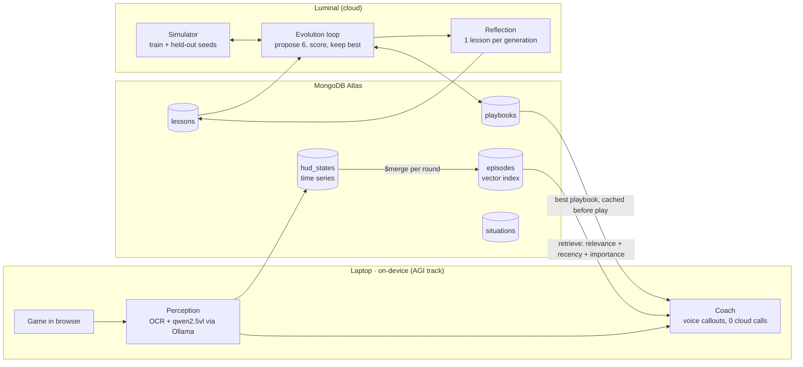

# ZombieLoop

**An on-device AI coach for Call of Duty: Black Ops Zombies. The coach evolves its own playbook in the cloud and only keeps the memories that make it better.**

> **Headline result:** _filled in from [results/RESULTS.md](results/RESULTS.md) after the final run. Every number below is rebuilt from MongoDB by `scripts/reproduce_chart.py`._

<!-- Replace with a GIF of the live demo: game + spoken callout + dashboard -->


📺 **90-second video:** _link_ · 🧪 **Results:** [results/RESULTS.md](results/RESULTS.md) · 🔬 **Research basis:** [MD files/RESEARCH.md](MD%20files/RESEARCH.md)  · 🎬 **Demo plan:** [MD files/DEMO.md](MD%20files/DEMO.md)

## What it does

1. **You play**: Kino der Toten in a browser ([vel.gg/bo1z](https://vel.gg/bo1z/kino), a fan-made WebAssembly port).
2. **On your laptop**, a local vision model reads the HUD (round, points, health, perks) and a coach speaks callouts like *"You have 2,600, buy Jugg now."* It makes no cloud model calls during play, so it keeps working with Wi-Fi off.
3. **In the cloud between games**, a Luminal-powered agent loop proposes new playbooks, tests them in a simulator, and keeps the best one, measured on **held-out seeds it never trained on**.
4. **MongoDB is the memory** shared by both sides. A lesson is kept only if it measurably improves held-out scores. Planted bad lessons get found and retired.

## Architecture



## Memory design (CoALA memory types)

| Layer | Paper | Collection |
| --- | --- | --- |
| Working | CoALA (Sumers et al., 2023) | `working_memory` (expires after 10 min) |
| Episodic | Generative Agents (Park et al., 2023), Memento (2025) | `hud_states` (time series) → `episodes` (case bank, vector index) |
| Procedural | Voyager, Agent Workflow Memory | `playbooks` (with `parent` lineage) |
| Semantic | Reflexion, ExpeL | `lessons` (evidence + status) |
| Taxonomic | A-Mem (NeurIPS 2025) | `situations` (tree) |

**Validated memory writes** follow Xiong et al. 2025, "How Memory Management Impacts LLM Agents". A lesson starts as a *candidate*. Each time a playbook that saw it is scored, the playbook's held-out gain is credited to the lesson. After 2+ uses it becomes *validated* (mean gain > 0) or *retired*. This happens in one transaction with the playbook's score. Details and citations are in [MD files/RESEARCH.md](MD%20files/RESEARCH.md).

## Verify our numbers

```bash
pip install -r requirements.txt
cp .env.example .env              # add MONGODB_URI
python scripts/reproduce_chart.py # rebuilds results/ from the database
```

Predictions were committed before the experiment ran; the commit hash is recorded in the `experiments` document and printed in RESULTS.md.

## Run it

```bash
pip install -r requirements.txt
python scripts/setup_db.py        # collections, indexes, situation tree (idempotent)
python scripts/smoke_test.py      # 12 checks against your cluster, cleans up after itself
```

## Honest limitations

- One run per arm. LLM proposals vary between runs, so the intervals cover seed variation only.
- The simulator is a simplified BO1 Zombies economy and is not the real game.
- Credit for a playbook's gain is shared equally by every lesson it was shown.
- Cluster runs MongoDB 8.0 (Atlas free tier). We make no MongoDB 9.0 performance claims.
- The game is an unofficial fan port. We link to it and include none of its files.

## Luminal strategy generation

For teammate integration, start with [TEAMMATE_HANDOFF.md](TEAMMATE_HANDOFF.md).

Run commands from this directory. Credentials stay in the ignored `.env` file.

```sh
python3 -m venv .venv
.venv/bin/python -m pip install -r requirements.txt
.venv/bin/python test_luminal.py
.venv/bin/python test_luminal.py --live
.venv/bin/python test_luminal.py --live --batch
```

`--live` sends a billable request to Luminal. The default test is offline.
Copy `.env.example` to `.env` only if you do not already have credentials configured.
The batch command starts four persona requests concurrently. Each may retry once
at the proposal level, in addition to SDK transient-error retries.

### Teammate integration

```python
from luminal_client import LuminalClient
from strategy import Strategy

client = LuminalClient()
result = client.generate(
    parent=Strategy.model_validate(parent_document['params']),
    parent_id=str(parent_document['_id']),
    diagnostics=run_summary['diagnostics'],
    fitness=run_summary['fitness'],
    generation=parent_document['generation'] + 1,
    persona='Tuner',  # Bold, Tuner, Defender, Explorer
    history=[],
)
# MongoDB owner persists result['strategy'] and result['llm_calls'].
# Controller reads result['strategy']['params'].
```

For a complete generation, call `client.generate_batch()` with the same arguments
except `persona`. It returns `strategies` (four child documents in Bold, Tuner,
Defender, Explorer order), flattened `llm_calls`, `generation`, total `latency_ms`,
and `fallback_count`. Each child retains its own parent ID and unique strategy ID.
One persona's API or output-validation failure produces its own fallback while
successful siblings are preserved. Shared invalid input is rejected before requests.

```python
batch = client.generate_batch(
    parent=parent_document['params'],
    parent_id=str(parent_document['_id']),
    diagnostics=run_summary['diagnostics'],
    fitness=run_summary['fitness'],
    generation=parent_document['generation'] + 1,
    history=[],
)
# MongoDB owner persists batch['strategies'] and batch['llm_calls'].
```

This initial batch uses one selected parent for all four personas. Top-two parent
selection, champion re-evaluation, and job claiming remain orchestrator responsibilities.

All twelve strategy fields are required. Numeric values are clamped; wrong types,
unknown fields, invalid enums, and nonfinite numbers are rejected. Persona constraints
are enforced after validation. Two proposal attempts are allowed; failed proposals
produce an explicitly marked local mutation fallback. The SDK separately retries
transient request errors twice. Logs exclude credentials and raw error bodies.

The Luminal client does not run games or write to MongoDB. The optional local
orchestrator described below handles ranking and file-based queueing. Sample
diagnostics are synthetic, not evidence of improvement.

### JSON handoff runner (one or two ranked parents)

Validate sample inputs without credentials or network requests:

```sh
.venv/bin/python generate_strategies.py --input examples/generation_input.json --dry-run
```

Generate four real proposals and export the handoff:

```sh
.venv/bin/python generate_strategies.py --input examples/generation_input.json --output outputs/generation-2.json
```

The example contains synthetic data. Replace it with actual run summaries to evaluate
real behavior. Each parent supplies `strategy_id`, `params`, `diagnostics`,
`mean_fitness`, and `evaluation_count`. Parents are already ranked, champion first;
the runner does not calculate rankings. `generation` and optional `history` are shared.
With two parents, Tuner and Defender modify the champion; Bold and Explorer modify
the runner-up. All personas see both parents as comparison context. With one parent,
all four use it. `parent_ids` records the actual mutation parent, not both references.

For Python integration use `generation.generate_generation(client, input_document)`.
Output has the same `strategies` and `llm_calls` batch structure as `generate_batch`.
Calls are linked to children by `strategy_id`; UTC timestamps and per-attempt prompt
hashes support audit logging. The CLI refuses to overwrite existing output files.
The `outputs/` directory is ignored by Git so run artifacts stay local by default.

### Complete local evolution loop

The standalone local orchestrator implements §3/§5.5's selection loop without MongoDB
or vision code. It queues two baseline runs, ranks evaluated strategies by mean
`points + 5 × survival_s`, retains the top two, generates four children, and queues
one champion re-evaluation every generation. Every historical evaluation contributes
to the mean. It waits for all issued jobs before advancing and retains full lineage,
run diagnostics, strategy rationales, and API call logs in a JSON state file.

```sh
.venv/bin/python evolve_local.py --state outputs/evolution.json init
.venv/bin/python evolve_local.py --state outputs/evolution.json jobs
# A game worker or teammate supplies results.json matching those job IDs.
.venv/bin/python evolve_local.py --state outputs/evolution.json ingest --results results.json
.venv/bin/python evolve_local.py --state outputs/evolution.json propose --dry-run
.venv/bin/python evolve_local.py --state outputs/evolution.json propose
.venv/bin/python evolve_local.py --state outputs/evolution.json status
```

`propose` without `--dry-run` calls Luminal. Repeat `jobs → ingest → propose` as
results arrive. The state is saved after every transition and can be resumed.
Use one process at a time per state file. An issued job has a unique `job_id`,
`strategy_id`, `kind`, and controller-ready `params`. Imported results are a JSON
array of objects in this shape (replace IDs with the actual issued IDs):

```json
[{
  "job_id": "issued-job-id",
  "strategy_id": "baseline",
  "worker": "laptop-1",
  "map": "kino",
  "points": 200,
  "survival_s": 112.0,
  "diagnostics": {"overshoot_rate": 0.58, "time_no_target_pct": 37}
}]
```

`points` means points gained, and survival is bounded to the plan's 180-second
horizon. Fitness is calculated locally rather than trusting an arbitrary supplied
fitness. Duplicate identical imports are harmless; conflicting imports, unknown
jobs, strategy mismatches, and invalid results are rejected before saving anything.
To avoid comparing incompatible hardware or maps, a local state uses one worker
and map. Multi-worker normalization belongs in the production orchestrator adapter.
Numeric diagnostics present in every run are averaged; other shared fields use the
latest value. Missing diagnostics are omitted instead of fabricated.

Exercise the full loop without credentials or teammates:

```sh
.venv/bin/python offline_demo.py
.venv/bin/python -m unittest discover -s tests -v
```

The offline demo uses fabricated constant scores and local mutations. It proves
control flow only, not Luminal usage or gameplay improvement.

### Reliability and configuration

Configure concurrency (1–4), request timeout, SDK transient retries, output token
budget, and optional JSON mode using `.env.example`. Prompt-only JSON is the
default; JSON mode is opt-in because endpoint support may vary. Each agent has
at most two proposal attempts, in addition to SDK retries with backoff.

All personas must change something. Bold changes 2–4 parameters; Tuner changes
1–2 numeric values by at most 15%; Defender changes only survival parameters;
Explorer changes only targeting or strafe mode. Prompts explain diagnostic units
and measurement limitations. Logs include clamped parameter names and children
include changed parameter names.

A failed agent first tries its last successful cached proposal, revalidating it
against the current parent and persona. Otherwise it makes a bounded local mutation.
Both paths are marked `fallback=true` and carry a `fallback_source`; neither is
reported as a fresh successful LLM call. Cache is in memory per client; the local
orchestrator restores it from successful strategies in its state when resumed.

Your MongoDB teammate can replace local storage while retaining the input/output
contracts. Your controller teammate executes jobs and supplies telemetry. Manual
restart, screen capture, detection, scoring/OCR collection, and worker-specific
normalization are not implemented in this Luminal module.
