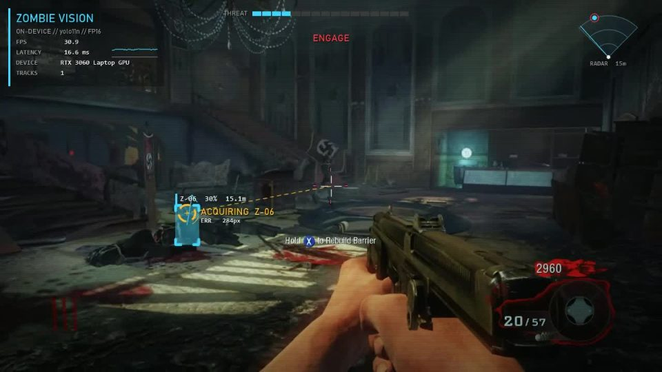
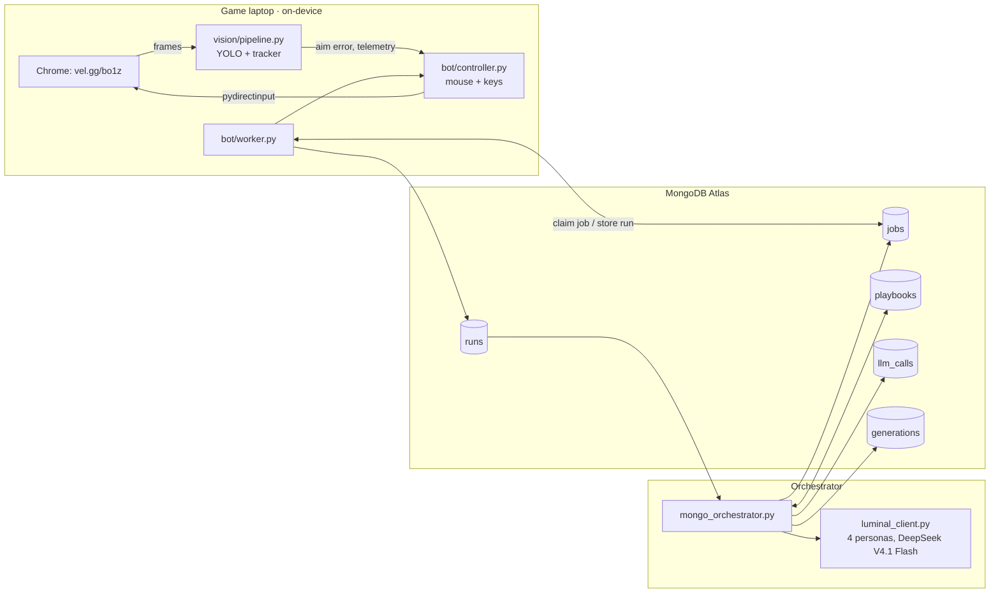

# Gulag Loop

**A team of Luminal agents evolves a bot that plays Call of Duty: Black Ops Zombies. The bot's eyes run on the laptop GPU, every strategy and run lives in MongoDB, and improvement is checked on runs the agents never trained on.**

Built at c0mpiled-15, Penn State, October 11, 2026. Game: the Black Ops 1 Zombies browser port ([vel.gg/bo1z](https://vel.gg/bo1z/kino), unofficial fan port), map Kino der Toten.



> **On-device AI plays a real game in real time; a team of Luminal agents rewrites its strategy from the evidence; MongoDB keeps every decision, run and replay.**
> In 2 generations of real games: average survival **49.0 s → 61.8 s**, first zombie spotted **19.2 s → 9.1 s**, detections per frame **~7×**. Pitch, sponsor fit and honest limits: [MD files/PITCH.md](MD%20files/PITCH.md).

## How it works

1. **On-device vision** (`vision/`) captures the game window, finds zombies with a distilled YOLO model (TensorRT, ~6 ms/frame), tracks them, and reports the aim error in pixels.
2. **A controller** turns that into mouse and keyboard input, following a 12-number **strategy** (aim gain, fire radius, retreat distance, strafing...).
3. **A worker** claims an evaluation job from MongoDB, plays one 3-minute run with that strategy, and stores points, survival and diagnostics.
4. **Four Luminal agents** (Bold, Tuner, Defender, Explorer) read the top two strategies and their diagnostics, and propose four new ones each generation. The current champion is re-run every generation, so one lucky run can't stay on top.
5. **MongoDB** holds every strategy, job, run and model call, saves each generation in one transaction, and computes the leaderboard and family tree.



## Status

| Part | Owner | Code | State |
| --- | --- | --- | --- |
| Vision: capture, detector, tracker, HUD | Rishit | `vision/`, `config.yaml` | Built. Distilled model reaches mAP50 0.58 against its teacher's labels; runs on Rishit's laptop (weights on `D:\czb`) |
| Strategy schema + Luminal agents | Jeffrey | `strategy.py`, `luminal_client.py`, `generation.py`, `evolution.py` | Built. 14 unit tests pass; live calls return valid proposals |
| MongoDB orchestration + memory | Deekshith | `mongo_orchestrator.py`, `common/`, `scripts/` | Built. 13 offline + 15 live end-to-end checks pass |
| Browser game driver | Rishit | `bot/game.py`, `tools/port_probe.py` | Built. Isolated Chrome on the dGPU, load/start/restart, pointer lock. **Gate 1 passes** (scripted mouse turns the camera) |
| Controller: mouse + keyboard | Rishit | `bot/controller.py` | Built. Executes all 12 strategy params, F8 abort, computes §5.4 diagnostics. **Gate 2 passes** (first autonomous kill on the port) |
| Worker: job → run → result | Rishit, Deekshith | `bot/worker.py` | Built. Calibrates mouse sensitivity, runs 180 s episodes; claims jobs from MongoDB and auto-proposes generations |
| Points OCR + game-over detection | Rishit | `bot/hudread.py` | Built (easyocr on fixed 720p crops) |
| Dashboard | Jeffrey | `dashboard/` | Built. Live worker viewport, interactive data flow, agent proposals, and combined MongoDB run history |

## Repository layout

```
vision/                 on-device eyes (see MD files/VISION.md)
bot/                    browser game driver, controller (mouse + keys), awareness, scoring, HUD OCR, worker
                        bot/loop.py: single-laptop loop with a JSON state file (no MongoDB)
tools/port_probe.py     Gate 1 / Gate 2 test on the browser port
config.yaml             capture window, model path, masks, calibrated per machine
strategy.py             the 12-parameter strategy schema shared with the controller
luminal_client.py       4 persona agents, validation, retries, fallbacks
generation.py           one generation from ranked parents
evolution.py            ranking, champion re-evaluation, job rules (pure functions)
evolve_local.py         same loop with a JSON file instead of MongoDB
mongo_orchestrator.py   same loop on MongoDB: atomic job queue, transactional generations
common/                 MongoDB connection, collection names, memory queries
scripts/                setup_db, smoke tests, end-to-end test, results chart
tests/                  offline unit tests (no network)
MD files/               all documentation (index below)
docs/img/               images used in the docs
```

## Setup

```bash
python -m venv .venv
.venv\Scripts\python -m pip install -r requirements.txt
copy .env.example .env          # fill in MONGODB_URI and LUMINAL_API_KEY
.venv\Scripts\python scripts\setup_db.py
```

The vision side needs CUDA PyTorch and TensorRT first; follow [MD files/VISION.md](MD%20files/VISION.md#setup-windows--nvidia-gpu).

## Run everything (game laptop)

```bash
python mongo_orchestrator.py --experiment exp-kino-1 init --map kino          # once
python -m bot.worker calibrate                                                 # once per machine
python -m bot.worker run --experiment exp-kino-1 --propose --generations 8     # plays, stores, evolves
```

The worker opens the game in its own Chrome, claims a job from MongoDB, plays a 180 s episode with that strategy, stores the run, and repeats. With `--propose`, when the queue is empty it asks Luminal for the next generation itself. Extra laptops run the same command without `--propose` and share the queue. **The mouse belongs to the game while it runs: F8 aborts (the job goes back in the queue), Esc in game releases the mouse.**

Games that cannot acquire control, lose it in the first five seconds, or close unexpectedly are not scored. The MongoDB worker requeues these jobs and retries, stopping after three consecutive invalid games with the job still queued. Fix game control before restarting.

Detector weights: `config.yaml` first, else `model/zombies_v1.engine` or `model/zombies_v1.pt` (gitignored). Large local files go to `D:/czb` if it exists, else `local_data/` (override with `CZB_DIR`).

### What the bot does on its own (not evolved)

- **Awareness** (`bot/awareness.py`): tracks its heading from the mouse counts it sends; remembers zombies that left the screen and turns toward the nearest; a red damage flash with nothing on screen makes it turn around and back off; learns the map's **entry points** (where zombies first appear) and stores them per map in MongoDB (`entry_events`), then watches them in turn; measures recoil per shot and pulls down against it.
- **Scoring** (`bot/scoring.py`): classifies each points-counter change with BO1 values (hit 10, headshot kill 100, torso 60…) into `headshot_rate_est` and related diagnostics, so the agents can see whether head aim pays off.
- **Rishit's safety rules**: engages only zombies confirmed over 3+ frames, fires when the crosshair is on the body, caps and levels pitch, reloads on empty, reads game-over twice.
- **HUD**: red layer on every zombie, highlighted head zone on the target, and a compass strip with remembered zombies, entry points and the active-zombie count.

### Team settings live in MongoDB

One place for every laptop instead of per-laptop files (`calibration.json` / `strategies.json` stay as offline fallbacks):

```bash
python -m bot.worker calibrate                       # saves to MongoDB machines/<this laptop> too
python -m common.machines list                       # every laptop's calibration + what this one uses
python -m common.machines publish-strategies zombie_bot/strategies.json
python -m bot.worker run --play champion --games 3   # best evolved strategy, straight from MongoDB
```

A laptop that hasn't calibrated uses the **team default** (median of all laptops). `champion` is the current best playbook from the MongoDB experiments; named styles (`best`, `aggressive`, `kiter`, ...) come from the `strategies` collection. Rishit's bundle reads the same data with `--strategy mongodb --name champion`.

## Run the evolution loop on MongoDB (manual steps)

```bash
python mongo_orchestrator.py --experiment exp-kino-1 init --map kino
python mongo_orchestrator.py --experiment exp-kino-1 claim --worker laptop-1   # job + strategy params for the controller
python mongo_orchestrator.py --experiment exp-kino-1 complete --result result.json
python mongo_orchestrator.py --experiment exp-kino-1 propose                   # calls Luminal (--dry-run to preview)
python mongo_orchestrator.py --experiment exp-kino-1 status
python mongo_orchestrator.py --experiment exp-kino-1 requeue --minutes 10      # jobs from a crashed worker
```

A result is `{"job_id", "strategy_id", "worker", "map", "points", "survival_s", "diagnostics"}`; fitness is `points + 5 × survival_s`.

| Collection | Holds |
| --- | --- |
| `playbooks` | Every strategy: params, persona, rationale, parent, champion flag |
| `jobs` | Evaluation queue (`queued` → `running` → `done`), claimed atomically |
| `runs` | One document per game run: points, survival, fitness, diagnostics |
| `llm_calls` | Every Luminal attempt: model, latency, tokens, prompt hash, success |
| `generations` | Champion and its mean fitness per generation |
| `experiments` | Map, current generation, start time |

The memory collections (`episodes`, `lessons`, `situations`, `hud_states`, `working_memory`) and their vector indexes are set up for lesson memory; see [MD files/RESEARCH.md](MD%20files/RESEARCH.md).

## Optional steady-state evolution + MongoDB agent memory (`bot/steady.py`, `bot/agent_memory.py`)
This is a separate game-laptop command; the dashboard controls still launch the MongoDB generation worker described above.

Every game is one step, so improvement shows game by game instead of every 9-game generation:
- **Champion/challenger:** a Luminal persona (Tuner → Bold → Defender → Explorer, rotating) proposes a change to the
  champion. A challenger that beats the champion's mean plays one confirmation game and is promoted only if its
  2-game mean still wins. The champion is re-evaluated every 5th game so its mean stays honest.
- **MongoDB is the agents' memory**, using the team's Atlas collections and indexes:
  - `episodes`: every game gets a 12-dim diagnostics vector (`episodes_vec`). Before each proposal, `$vectorSearch`
    retrieves the most similar past games (what changed, what happened) into the agent's context.
  - `lessons`: a promotion writes a *candidate*. The champion's next re-evaluation *validates* or *retires* it in
    a multi-document transaction with the experiment record. Lessons matching the current situation go to the agent.
  - `hud_states` time series: every 2 s heartbeat. `$setWindowFields` gives per-game trends.
  - Each proposed strategy stores `memory_context` (retrieved episode ids, similarities, lessons). A separate
    dashboard panel on branch `rishit/dashboard-memory` displays it; that panel is not included here.
- **Results so far (`rishit-steady`, Kino):** baseline mean 378 over 3 games, current champion (Tuner) 450 over 3
  games (+19%). The best single game scored 2 kills, +410 points, 72 s. Samples are small and single games are noisy.

```bash
python -m bot.steady --state D:/czb/evo_state/steady.json --minutes 30 --publish   # memory on by default
python -m tools.steady_report      # champion-mean curve + promotions
```

## Tests

| Command | What it checks | Network |
| --- | --- | --- |
| `python -m unittest discover -s tests` | Strategy validation, personas, evolution rules | none |
| `python scripts/smoke_test.py` | Memory layer: vector search, retrieval scoring, lesson lifecycle | MongoDB |
| `python scripts/test_mongo_luminal.py` | Full loop on MongoDB with mock agents | MongoDB |
| `python scripts/test_mongo_luminal.py --live` | Same, generation 1 from real Luminal agents (billable) | MongoDB + Luminal |
| `python scripts/test_worker_mongo.py` | Real `bot/worker.py` loop on MongoDB with game, vision and mouse faked: claim, F8 requeue, store, auto-propose 2 generations | MongoDB |
| `python scripts/test_worker_mongo.py --live` | Same, proposals from real Luminal | MongoDB + Luminal |
| `python -m tools.port_probe --map kino --gate1 --bot-seconds 60` | Real game: Gate 1 + 60 s of bot (**takes the mouse**) | game |
| `python test_luminal.py --live` | One Luminal proposal | Luminal |

All run results in these tests are synthetic; they prove the plumbing, not gameplay improvement.

## Documentation

| Document | Contents |
| --- | --- |
| [Build plan](MD%20files/cod-zombies-agent-plan.md) | Full design, module specs, risks, timeline, video script |
| [Vision](MD%20files/VISION.md) | Detector distillation, speed, tracker, HUD, setup |
| [Luminal](MD%20files/LUMINAL.md) | Strategy generation, personas, JSON handoff, local loop |
| [Teammate handoff](MD%20files/TEAMMATE_HANDOFF.md) | Integration contracts between the three parts |
| [Architecture](MD%20files/ARCHITECTURE.md) | MongoDB connection map |
| [Research](MD%20files/RESEARCH.md) | Memory design and the papers behind it |
| [Demo](MD%20files/DEMO.md) | 90-second video shot list |

## Limitations

- The detector was trained on footage of the original game, not the browser port, and on its teacher's labels rather than ground truth.
- On the port the detector sees zombies in only ~10% of frames so far; episodes save raw port frames for retraining.
- The steady-state results above are a small preliminary gameplay sample, not a controlled benchmark. Automated integration tests use synthetic games.
- Cluster runs MongoDB 8.0 (Atlas free tier); we make no MongoDB 9.0 performance claims.
- The game is an unofficial fan port; we link to it and include none of its files.

## Backend dashboard

Run `.venv/bin/python -m dashboard.server` and open http://127.0.0.1:8765 to watch
vision/game telemetry, MongoDB activity, and all four Luminal agents. Install the
lightweight dependencies with `.venv/bin/python -m pip install -r requirements-dashboard.txt`.
The dashboard shows the live backend only. All experiments appear together, with one chronological run history and older results available through Load older runs.
See [dashboard setup and controls](MD%20files/DASHBOARD.md), including the difference
between pausing dashboard refresh and stopping the game worker.
