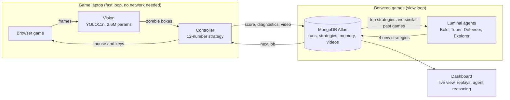
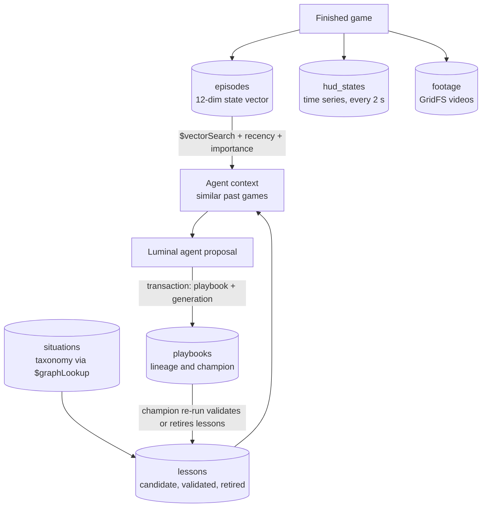
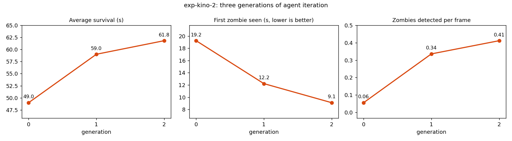
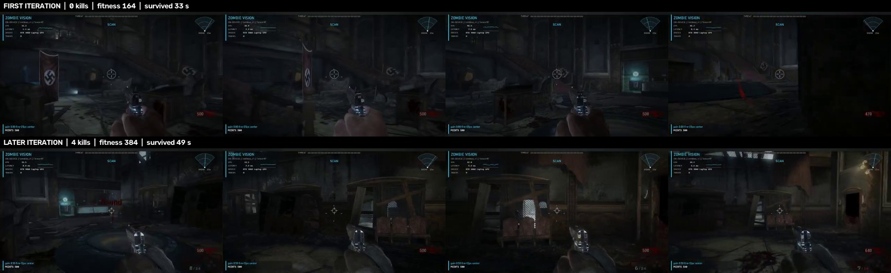
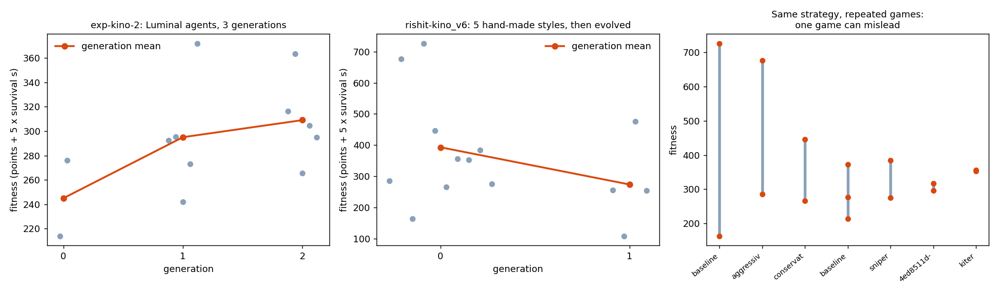

# Gulag Loop

**An on-device AI plays Call of Duty: Black Ops Zombies in real time. A team of Luminal agents rewrites its strategy between games. MongoDB remembers everything.**

**Live dashboard:** [zombieloop-dashboard.onrender.com](https://zombieloop-dashboard.onrender.com/) (read-only; shows the live game when the game laptop is online, otherwise the recorded games)

Built at c0mpiled-15, Penn State, October 11, 2026. The game is the Black Ops 1 Zombies browser port ([vel.gg/bo1z](https://vel.gg/bo1z/kino), unofficial fan port), map Kino der Toten.


## Contents

1. [The idea](#the-idea)
2. [How it works](#how-it-works)
3. [On-device AI](#on-device-ai)
4. [Luminal agents](#luminal-agents)
5. [MongoDB memory](#mongodb-memory)
6. [Results](#results)
7. [Is it overfitting?](#is-it-overfitting)
8. [Quick start](#quick-start)
9. [Dashboard](#dashboard)
10. [Repository layout](#repository-layout)
11. [Tests](#tests)
12. [Documentation](#documentation)
13. [Limitations](#limitations)

## The idea

Game studios pay people to play builds over and over. We built an agent that does it, and gets better at it.

- **Fast loop, on the laptop.** A 2.6M-parameter vision model sees zombies, a controller aims and fires, and the game is played at about 30 decisions per second with no cloud calls.
- **Slow loop, in the cloud.** Between games, four Luminal agents read what went wrong, explain it, and propose new strategies. Each proposal is played for real, scored, and kept only if it wins.
- **Shared memory.** MongoDB stores every strategy, run, agent call, lesson and video, so the whole improvement history can be inspected and replayed.

## How it works



The loop, one generation at a time:

1. **Claim.** A worker claims an evaluation job from MongoDB (atomic, so laptops never double-book).
2. **Play.** It plays one 3-minute game with that strategy, fully on the laptop.
3. **Store.** Points, survival time, diagnostics and the game video are written to MongoDB.
4. **Propose.** When the queue is empty, four Luminal agents read the best two strategies, their diagnostics and similar past games, and each proposes a new strategy.
5. **Repeat.** The current champion is re-run every generation, so one lucky game cannot stay on top.

## On-device AI

Everything needed to play runs on the laptop GPU. Once the game is open, perception and control make no network calls, so a dropped connection never stalls a game.

| | |
| --- | --- |
| Model | YOLO11n zombie detector, 2.6M parameters |
| Size | 5.5 MB (.pt), 8 MB TensorRT FP16 engine, 10.7 MB ONNX |
| Speed | 4 to 8 ms per frame on an RTX 4060 laptop GPU |
| Training | Distilled from YOLOE-11L, an open-vocabulary model roughly 10x larger, which labeled real gameplay frames |
| Decision rate | About 30 per second |
| Portability | ONNX export targets CPUs, NPUs and browsers |

What runs locally besides the detector: a tracker, a heading and zombie memory (awareness of zombies that left the screen), entry-point learning, points OCR from the HUD, and the mouse and keyboard controller.

Cloud services are used only between games, and the system degrades gracefully: if Luminal is unreachable, agents fall back to validated local proposals, and `bot/loop.py` with `evolve_local.py` runs the same evolution loop from a JSON file with no MongoDB at all.

Not done yet: INT8 quantization. The benchmark script exists (`scripts/compress_model.py`) but has not been run, so we do not claim a quantized model.

### The dataset

We collected and edited the training images ourselves: more than 500 hand-checked frames in the first pass, growing to **2,629 labeled frames** (2,469 from original-game footage and 160 captured from the browser port).

- **Collected:** gameplay frames sampled every 0.25 s from footage, plus frames the bot saves from the browser port during real games (over 1,700 raw port frames so far).
- **Edited:** the player's own hand and weapon, the round tally and the points and ammo HUD are painted black so the model learns zombies, not the interface. Wide boxes (corpses) are filtered out, and labels from the large teacher model are reviewed before training.
- **Split:** a whole clip is held out for validation, so validation frames are not near-copies of training frames.

Details: [MD files/VISION.md](MD%20files/VISION.md).

## Luminal agents

Four personas with different instincts propose strategies in parallel:

| Persona | Bias |
| --- | --- |
| Bold | Large changes, high variance |
| Tuner | Small adjustments to the champion |
| Defender | Survival first: retreat distance, strafing |
| Explorer | Unusual parameter combinations |

- A strategy is 12 numbers (aim gain, fire radius, detection threshold, retreat distance, strafing, scan speed and others). Every proposal is validated against a schema before it is played.
- Agents see the diagnostics from real runs, such as "89.8% of time with no target", and reason from them. In our runs two agents independently lowered the detection threshold, and perception improved in the next generation.
- Every call is logged (model, latency, tokens, prompt hash, success), with retries and fallbacks.
- The loop mirrors Luminal's own idea: search over candidates, measure, keep the fastest. We search over strategies and measure them in the game.
- Model: DeepSeek V4.1 Flash through Luminal's OpenAI-compatible endpoint.

Details: [MD files/LUMINAL.md](MD%20files/LUMINAL.md).

## MongoDB memory

MongoDB is the shared brain for every laptop and every agent. It is more than a log: the agents retrieve from it before they propose.



Memory types, following the agent-memory literature ([MD files/RESEARCH.md](MD%20files/RESEARCH.md)):

| Type | Collection | What it does |
| --- | --- | --- |
| Episodic | `episodes` | Every game becomes a case with a 12-dim state vector. Retrieval uses `$vectorSearch`, then scores relevance, recency and importance (Generative Agents style) in one aggregation with `$setWindowFields`. |
| Semantic | `lessons`, `situations` | Short written lessons tagged with situations. Tags inherit through a taxonomy walked with `$graphLookup`. |
| Validated writes | `lessons`, `playbooks` | A lesson starts as a candidate. When the strategy that used it is re-evaluated, a multi-document transaction promotes it to validated or retires it. Bad advice does not stay in memory. |
| Procedural | `playbooks` | Every strategy with parent links, so the family tree and champion lineage are one query. |
| Working | `working_memory` | Short-lived coach state with a TTL index. |
| Telemetry | `hud_states` | Time series collection of live game state. |
| Evidence | `footage` | Every game video in GridFS, tagged by generation, kills and fitness. |
| Team settings | `machines`, `strategies` | Per-laptop mouse calibration with a team default (median), and named strategies. |

Operational collections: `jobs` (atomic claim queue), `runs`, `llm_calls`, `generations`, `experiments`.

Steady-state mode (`bot/steady.py`, `bot/agent_memory.py`) uses the episodic and lesson memory directly: before each proposal it retrieves the most similar past games and matching lessons into the agent's context, and each proposal stores which memories it used. The generation worker uses the playbook, job, run and footage collections.

The cluster runs MongoDB 8.0 on the Atlas free tier. Details: [MD files/ARCHITECTURE.md](MD%20files/ARCHITECTURE.md).

## Results

Real games, read from MongoDB (experiment `exp-kino-2`):

| | Generation 0 (baseline) | Generation 2 (evolved) |
| --- | --- | --- |
| Average survival | 49.0 s | 61.8 s |
| First zombie seen | 19.2 s | 9.1 s |
| Detections per frame | 0.06 | 0.41 |
| Best fitness (points + 5 x survival) | 276 | 372 |

Luminal: 9 agent calls, 8 valid on the first try, 0 fallbacks.

The best strategy found by the team so far is "Aggressive" in experiment `rishit-kino_v6` (mean fitness 481 over 2 games). New dashboard runs are seeded from it automatically. Recorded games from that experiment are what the dashboard replays when nothing is live, including the first iteration (0 kills) for comparison.



It gets better as the agents iterate, and this is with very few iterations: three generations and a handful of games each. The agents found that the bot was spending most of its time with nothing in view, lowered the detection threshold, and perception improved in the next generation.

### Zero kills versus four kills

The first game of the `rishit-kino_v6` experiment, before any learning, against a later game from the same experiment. Frames are sampled evenly across each game.



| | First iteration | Later iteration |
| --- | --- | --- |
| Kills | 0 | 4 |
| Fitness | 164 | 384 |
| Survival | 33 s | 49 s |
| Points counter at the end | 470 (lost points) | 640 (gained points) |

In the dashboard, the viewport replays these recordings when nothing is live. The "Show first" button switches between the best game and the first iteration so you can compare them yourself. Early results from small samples: the trend is encouraging, the numbers are not yet statistically firm.

More: [MD files/PITCH.md](MD%20files/PITCH.md).

## Is it overfitting?

We checked both learners, and the evidence is below. It supports "no sign of overfitting", not "proven to generalize": the held-out-map test has not been run.

**The detector.** Validation uses a whole held-out clip (`kino_solo_mid`), not random frames, so validation images are not near-copies of training images.


- Training loss keeps falling, as expected. Validation loss falls and then flattens around epoch 35 to 40 instead of climbing, and mAP50 settles near 0.55 to 0.58. There is a slight dip after the peak, so we keep the model small (2.6M parameters) and stop at 60 epochs.
- The real test is a different source. It trained on footage of the original game, and on the browser port it still finds zombies with recall and precision around 0.60 at confidence 0.25, so it is not memorizing one clip.
- Caveat: these scores are against the teacher model's labels, not hand-labeled ground truth.

**The strategies.** One game is a poor judge of a strategy, so we never promote on a single game.



- Left: in `exp-kino-2` the generation mean rises from 245 to 295 to 309 over fresh games. Each dot is a separate real game, and the line is the mean, not the best.
- Middle: in `rishit-kino_v6` the second generation scored lower than the first (4 games, one ended at 22 s). We show this on purpose. It is a small sample, and it is why the dashboard seeds new runs from the best strategy by mean over several games.
- Right: the same strategy replayed in the same experiment ranges from 163 to 726 fitness. This noise is why the champion is re-run every generation and a challenger must win again on a confirmation game before it is promoted.
- Agents only see diagnostics from past games, and every proposal is played on a new game, so a strategy cannot score well by memorizing a game.

Regenerate the chart from MongoDB with `python scripts/evidence_charts.py`.

## Quick start

```bash
python -m venv .venv
.venv\Scripts\python -m pip install -r requirements.txt
copy .env.example .env          # fill in MONGODB_URI and LUMINAL_API_KEY
.venv\Scripts\python scripts\setup_db.py
```

The vision side needs CUDA PyTorch and TensorRT first. See [MD files/VISION.md](MD%20files/VISION.md#setup-windows--nvidia-gpu). Put the detector weights in `model/` (git-ignored). Large local files go to `D:/czb` if it exists, else `local_data/` (override with `CZB_DIR`).

Play and evolve (game laptop):

```bash
python mongo_orchestrator.py --experiment exp-kino-1 init --map kino          # once
python -m bot.worker calibrate                                                 # once per machine
python -m bot.worker run --experiment exp-kino-1 --propose --generations 8     # plays, stores, evolves
```

Useful flags for `bot.worker run`: `--stream --headless` (play without a visible window and stream it to the dashboard), `--strategy mongodb --name champion` (play the best evolved strategy), `--slot`, `--wait-s`.

- Extra laptops run the same command without `--propose` and share the queue.
- **The mouse belongs to the game while it runs.** F8 aborts (the job goes back in the queue). Esc in game releases the mouse. Headless mode avoids this.
- Games that never acquire control, lose it in the first five seconds, or close unexpectedly are not scored. The job is requeued, and the worker stops after three consecutive invalid games.

Manual orchestration commands:

```bash
python mongo_orchestrator.py --experiment exp-kino-1 claim --worker laptop-1
python mongo_orchestrator.py --experiment exp-kino-1 complete --result result.json
python mongo_orchestrator.py --experiment exp-kino-1 propose        # --dry-run to preview
python mongo_orchestrator.py --experiment exp-kino-1 status
python mongo_orchestrator.py --experiment exp-kino-1 requeue --minutes 10
```

Fitness is `points + 5 x survival_s`.

Shared calibration and strategies:

```bash
python -m common.machines list
python -m common.machines publish-strategies zombie_bot/strategies.json
python -m common.machines strategy champion
```

## Dashboard

```bash
python -m pip install -r requirements-dashboard.txt
python -m dashboard.server        # http://127.0.0.1:8765
```

- **Watch:** the live game with the HUD overlay (red layer on zombies, head zone, 360 degree radar), a HUD/RAW toggle and fullscreen.
- **Control (local only):** start and stop the bot from the page.
- **Learn:** the four agents' reasoning, strategy lineage, run history and model calls.
- **Replay:** when nothing is live, the viewport plays recorded games, with a button to compare the best game against the first iteration. These are labeled as replays, never as live.
- **Hosting:** `python -m dashboard.server --read-only` (used by `render.yaml`) serves the same pages with game control disabled. A game laptop can expose its live stream through a tunnel, and the hosted page falls back to the recordings when the stream is unavailable.

Setup and controls: [MD files/DASHBOARD.md](MD%20files/DASHBOARD.md).

## Repository layout

```
vision/                 on-device eyes: detector, tracker, HUD (see MD files/VISION.md)
bot/                    game driver, controller, awareness, scoring, OCR, worker, livestream
common/                 MongoDB connection, memory queries, shared machines and strategies
dashboard/              live dashboard and local game control
strategy.py             12-parameter strategy schema
luminal_client.py       4 persona agents, validation, retries, fallbacks
generation.py           one generation from ranked parents
evolution.py            ranking, champion re-evaluation, job rules (pure functions)
evolve_local.py         same loop with a JSON file instead of MongoDB
mongo_orchestrator.py   same loop on MongoDB: atomic job queue, transactional generations
scripts/                setup, smoke tests, charts, footage upload, compression benchmark
tests/                  offline unit tests
MD files/               all documentation
docs/img/               images used in the docs
```

## Tests

| Command | What it checks | Needs |
| --- | --- | --- |
| `python -m pytest tests` | Strategy validation, personas, evolution rules, dashboard data | nothing |
| `python scripts/smoke_test.py` | Memory layer: vector search, retrieval scoring, lesson lifecycle | MongoDB |
| `python scripts/test_mongo_luminal.py` | Full loop on MongoDB with mock agents (`--live` uses real Luminal) | MongoDB |
| `python scripts/test_worker_mongo.py` | Real worker loop with game, vision and mouse faked | MongoDB |
| `python scripts/test_awareness.py` | Heading, zombie memory and entry-point learning | nothing |
| `python -m tools.port_probe --map kino --gate1 --bot-seconds 60` | Real game, **takes the mouse** | game |

Results in the synthetic tests prove the plumbing, not gameplay improvement.

## Documentation

| Document | Contents |
| --- | --- |
| [Pitch](MD%20files/PITCH.md) | Measured results, sponsor fit, honest limits |
| [Build plan](MD%20files/cod-zombies-agent-plan.md) | Full design, module specs, risks, timeline |
| [Vision](MD%20files/VISION.md) | Detector distillation, speed, tracker, HUD, setup |
| [Luminal](MD%20files/LUMINAL.md) | Strategy generation, personas, JSON handoff, local loop |
| [Architecture](MD%20files/ARCHITECTURE.md) | MongoDB connection map |
| [Research](MD%20files/RESEARCH.md) | Memory design and the papers behind it |
| [Dashboard](MD%20files/DASHBOARD.md) | Setup, controls, hosting |
| [Replicate](MD%20files/REPLICATE.md) | Reproducing the results |
| [Teammate handoff](MD%20files/TEAMMATE_HANDOFF.md) | Integration contracts between the three parts |
| [Demo](MD%20files/DEMO.md) | 90-second video shot list |

## Limitations

- The bot sees and tracks zombies but lands few kills so far. Most gains are in perception and survival, not points.
- Small samples: a handful of games per generation on one map. A held-out-map test script exists (`scripts/heldout_eval.py`) but was not run to completion.
- The detector was distilled from a teacher's labels, not hand-labeled ground truth, and was not benchmarked head to head against the teacher.
- The model is not quantized yet; the INT8 benchmark is scripted but unrun.
- Steady-state results are a small preliminary sample, not a controlled benchmark.
- The game is an unofficial fan port; we link to it and include none of its files.
