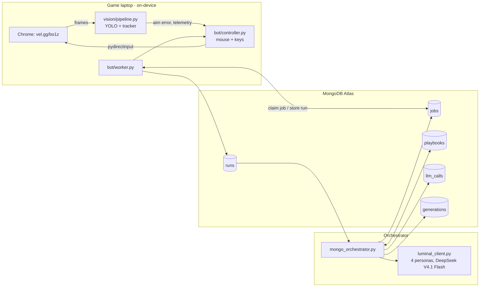

# Self-Improving Zombies Agents

**A team of Luminal agents evolves a bot that plays Call of Duty: Black Ops Zombies. The bot's eyes run on the laptop GPU, every strategy and run lives in MongoDB, and improvement is checked on runs the agents never trained on.**

Built at c0mpiled-15, Penn State, October 11, 2026. Game: the Black Ops 1 Zombies browser port ([vel.gg/bo1z](https://vel.gg/bo1z/kino), unofficial fan port), map Kino der Toten.


## How it works

1. **On-device vision** (`vision/`) captures the game window, finds zombies with a distilled YOLO model (TensorRT, ~6 ms/frame), tracks them, and reports the aim error in pixels.
2. **A controller** turns that into mouse and keyboard input, following a 12-number **strategy** (aim gain, fire radius, retreat distance, strafing...).
3. **A worker** claims an evaluation job from MongoDB, plays one 3-minute run with that strategy, and stores points, survival and diagnostics.
4. **Four Luminal agents** (Bold, Tuner, Defender, Explorer) read the top two strategies and their diagnostics, and propose four new ones each generation. The current champion is re-run every generation, so one lucky run can't stay on top.
5. **MongoDB** holds every strategy, job, run and model call, saves each generation in one transaction, and computes the leaderboard and family tree.



## Status

| Part | Owner | Code | State |
| --- | --- | --- | --- |
| Vision: capture, detector, tracker, HUD | Rishit | `vision/`, `config.yaml` | Built. Distilled model reaches mAP50 0.58 against its teacher's labels; runs on Rishit's laptop (weights on `D:\czb`) |
| Strategy schema + Luminal agents | Jeffrey | `strategy.py`, `luminal_client.py`, `generation.py`, `evolution.py` | Built. 14 unit tests pass; live calls return valid proposals |
| MongoDB orchestration + memory | Deekshith | `mongo_orchestrator.py`, `common/`, `scripts/` | Built. 13 offline + 15 live end-to-end checks pass |
| Browser game driver | Rishit | `bot/game.py`, `tools/port_probe.py` | Built. Isolated Chrome on the dGPU, load/start/restart, pointer lock. **Gate 1 passes** (scripted mouse turns the camera) |
| Controller: mouse + keyboard | Rishit | `bot/controller.py` | Built. Executes all 12 strategy params, F8 abort, computes §5.4 diagnostics. **Gate 2 passes** (first autonomous kill on the port) |
| Worker: job → run → result | Rishit, Deekshith | `bot/worker.py` | Built. Calibrates mouse sensitivity, runs 180 s episodes; claims jobs from MongoDB and auto-proposes generations |
| Points OCR + game-over detection | Rishit | `bot/hudread.py` | Built (easyocr on fixed 720p crops) |
| Dashboard | — | — | **Not built** (data and queries exist: `leaderboard()`, `playbook_lineage()`) |

## Repository layout

```
vision/                 on-device eyes (see MD files/VISION.md)
bot/                    browser game driver, controller (mouse + keys), HUD OCR, worker
tools/port_probe.py     Gate 1 / Gate 2 test on the browser port
config.yaml             capture window, model path, masks, calibrated per machine
strategy.py             the 12-parameter strategy schema shared with the controller
luminal_client.py       4 persona agents, validation, retries, fallbacks
generation.py           one generation from ranked parents
evolution.py            ranking, champion re-evaluation, job rules (pure functions)
evolve_local.py         same loop with a JSON file instead of MongoDB
mongo_orchestrator.py   same loop on MongoDB: atomic job queue, transactional generations
common/                 MongoDB connection, collection names, memory queries
scripts/                setup_db, smoke tests, end-to-end test, results chart
tests/                  offline unit tests (no network)
MD files/               all documentation (index below)
docs/img/               images used in the docs
```

## Setup

```bash
python -m venv .venv
.venv\Scripts\python -m pip install -r requirements.txt
copy .env.example .env          # fill in MONGODB_URI and LUMINAL_API_KEY
.venv\Scripts\python scripts\setup_db.py
```

The vision side needs CUDA PyTorch and TensorRT first; follow [MD files/VISION.md](MD%20files/VISION.md#setup-windows--nvidia-gpu).

## Run everything (game laptop)

```bash
python mongo_orchestrator.py --experiment exp-kino-1 init --map kino          # once
python -m bot.worker calibrate                                                 # once per machine
python -m bot.worker run --experiment exp-kino-1 --propose --generations 8     # plays, stores, evolves
```

The worker opens the game in its own Chrome, claims a job from MongoDB, plays a 180 s episode with that strategy, stores the run, and repeats. With `--propose`, when the queue is empty it asks Luminal for the next generation itself. Extra laptops run the same command without `--propose` and share the queue. **The mouse belongs to the game while it runs: F8 aborts (the job goes back in the queue), Esc in game releases the mouse.**

Detector weights: `config.yaml` first, else `model/zombies_v1.engine` or `model/zombies_v1.pt` (gitignored). Large local files go to `D:/czb` if it exists, else `local_data/` (override with `CZB_DIR`).

## Run the evolution loop on MongoDB (manual steps)

```bash
python mongo_orchestrator.py --experiment exp-kino-1 init --map kino
python mongo_orchestrator.py --experiment exp-kino-1 claim --worker laptop-1   # job + strategy params for the controller
python mongo_orchestrator.py --experiment exp-kino-1 complete --result result.json
python mongo_orchestrator.py --experiment exp-kino-1 propose                   # calls Luminal (--dry-run to preview)
python mongo_orchestrator.py --experiment exp-kino-1 status
python mongo_orchestrator.py --experiment exp-kino-1 requeue --minutes 10      # jobs from a crashed worker
```

A result is `{"job_id", "strategy_id", "worker", "map", "points", "survival_s", "diagnostics"}`; fitness is `points + 5 × survival_s`.

| Collection | Holds |
| --- | --- |
| `playbooks` | Every strategy: params, persona, rationale, parent, champion flag |
| `jobs` | Evaluation queue (`queued` → `running` → `done`), claimed atomically |
| `runs` | One document per game run: points, survival, fitness, diagnostics |
| `llm_calls` | Every Luminal attempt: model, latency, tokens, prompt hash, success |
| `generations` | Champion and its mean fitness per generation |
| `experiments` | Map, current generation, start time |

The memory collections (`episodes`, `lessons`, `situations`, `hud_states`, `working_memory`) and their vector indexes are set up for lesson memory; see [MD files/RESEARCH.md](MD%20files/RESEARCH.md).

## Tests

| Command | What it checks | Network |
| --- | --- | --- |
| `python -m unittest discover -s tests` | Strategy validation, personas, evolution rules | none |
| `python scripts/smoke_test.py` | Memory layer: vector search, retrieval scoring, lesson lifecycle | MongoDB |
| `python scripts/test_mongo_luminal.py` | Full loop on MongoDB with mock agents | MongoDB |
| `python scripts/test_mongo_luminal.py --live` | Same, generation 1 from real Luminal agents (billable) | MongoDB + Luminal |
| `python scripts/test_worker_mongo.py` | Real `bot/worker.py` loop on MongoDB with game, vision and mouse faked: claim, F8 requeue, store, auto-propose 2 generations | MongoDB |
| `python scripts/test_worker_mongo.py --live` | Same, proposals from real Luminal | MongoDB + Luminal |
| `python -m tools.port_probe --map kino --gate1 --bot-seconds 60` | Real game: Gate 1 + 60 s of bot (**takes the mouse**) | game |
| `python test_luminal.py --live` | One Luminal proposal | Luminal |

All run results in these tests are synthetic; they prove the plumbing, not gameplay improvement.

## Documentation

| Document | Contents |
| --- | --- |
| [Build plan](MD%20files/cod-zombies-agent-plan.md) | Full design, module specs, risks, timeline, video script |
| [Vision](MD%20files/VISION.md) | Detector distillation, speed, tracker, HUD, setup |
| [Luminal](MD%20files/LUMINAL.md) | Strategy generation, personas, JSON handoff, local loop |
| [Teammate handoff](MD%20files/TEAMMATE_HANDOFF.md) | Integration contracts between the three parts |
| [Architecture](MD%20files/ARCHITECTURE.md) | MongoDB connection map |
| [Research](MD%20files/RESEARCH.md) | Memory design and the papers behind it |
| [Demo](MD%20files/DEMO.md) | 90-second video shot list |

## Limitations

- The detector was trained on footage of the original game, not the browser port, and on its teacher's labels rather than ground truth.
- On the port the detector sees zombies in only ~10% of frames so far; episodes save raw port frames for retraining.
- No gameplay improvement has been measured yet; all test runs are synthetic.
- Cluster runs MongoDB 8.0 (Atlas free tier); we make no MongoDB 9.0 performance claims.
- The game is an unofficial fan port; we link to it and include none of its files.
