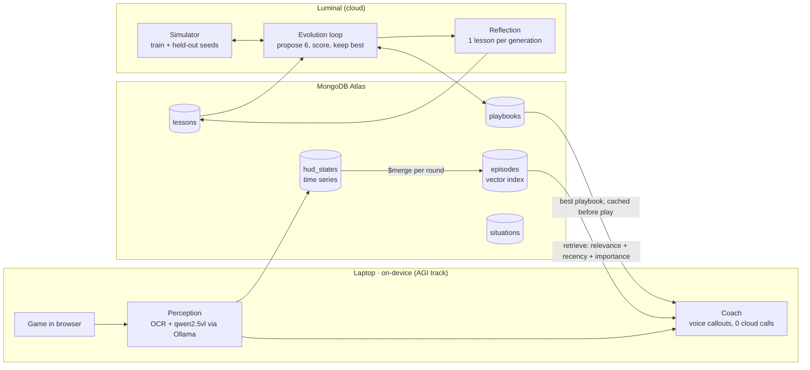

# ZombieLoop

**An on-device AI coach for Call of Duty: Black Ops Zombies. The coach evolves its own playbook in the cloud and only keeps the memories that make it better.**

> **Headline result:** _filled in from [results/RESULTS.md](results/RESULTS.md) after the final run. Every number below is rebuilt from MongoDB by `scripts/reproduce_chart.py`._

<!-- Replace with a GIF of the live demo: game + spoken callout + dashboard -->


📺 **90-second video:** _link_ · 🧪 **Results:** [results/RESULTS.md](results/RESULTS.md) · 🔬 **Research basis:** [MD files/RESEARCH.md](MD%20files/RESEARCH.md)  · 🎬 **Demo plan:** [MD files/DEMO.md](MD%20files/DEMO.md)

## What it does

1. **You play**: Kino der Toten in a browser ([vel.gg/bo1z](https://vel.gg/bo1z/kino), a fan-made WebAssembly port).
2. **On your laptop**, a local vision model reads the HUD (round, points, health, perks) and a coach speaks callouts like *"You have 2,600, buy Jugg now."* It makes no cloud model calls during play, so it keeps working with Wi-Fi off.
3. **In the cloud between games**, a Luminal-powered agent loop proposes new playbooks, tests them in a simulator, and keeps the best one, measured on **held-out seeds it never trained on**.
4. **MongoDB is the memory** shared by both sides. A lesson is kept only if it measurably improves held-out scores. Planted bad lessons get found and retired.

## Architecture



## Memory design (CoALA memory types)

| Layer | Paper | Collection |
| --- | --- | --- |
| Working | CoALA (Sumers et al., 2023) | `working_memory` (expires after 10 min) |
| Episodic | Generative Agents (Park et al., 2023), Memento (2025) | `hud_states` (time series) → `episodes` (case bank, vector index) |
| Procedural | Voyager, Agent Workflow Memory | `playbooks` (with `parent` lineage) |
| Semantic | Reflexion, ExpeL | `lessons` (evidence + status) |
| Taxonomic | A-Mem (NeurIPS 2025) | `situations` (tree) |

**Validated memory writes** follow Xiong et al. 2025, "How Memory Management Impacts LLM Agents". A lesson starts as a *candidate*. Each time a playbook that saw it is scored, the playbook's held-out gain is credited to the lesson. After 2+ uses it becomes *validated* (mean gain > 0) or *retired*. This happens in one transaction with the playbook's score. Details and citations are in [MD files/RESEARCH.md](MD%20files/RESEARCH.md).

## Verify our numbers

```bash
pip install -r requirements.txt
cp .env.example .env              # add MONGODB_URI
python scripts/reproduce_chart.py # rebuilds results/ from the database
```

Predictions were committed before the experiment ran; the commit hash is recorded in the `experiments` document and printed in RESULTS.md.

## Run it

```bash
pip install -r requirements.txt
python scripts/setup_db.py        # collections, indexes, situation tree (idempotent)
python scripts/smoke_test.py      # 12 checks against your cluster, cleans up after itself
```

## Honest limitations

- One run per arm. LLM proposals vary between runs, so the intervals cover seed variation only.
- The simulator is a simplified BO1 Zombies economy and is not the real game.
- Credit for a playbook's gain is shared equally by every lesson it was shown.
- Cluster runs MongoDB 8.0 (Atlas free tier). We make no MongoDB 9.0 performance claims.
- The game is an unofficial fan port. We link to it and include none of its files.

